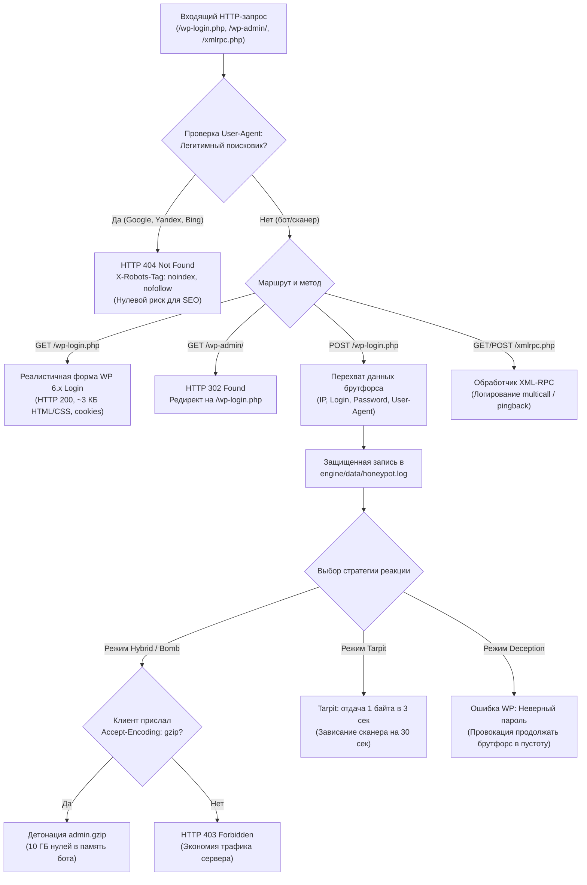

<p align="center">
  
</p>

# WordPress Honeypot & Threat Intelligence for DataLife Engine (DLE 14 - 21+)

[](https://dle-news.ru/)
[](https://php.net/)
[](LICENSE)
[](https://github.com/shlyahten/dle-wordpress-honeypot)

Интеллектуальный модуль защиты и сбора аналитики угроз (Threat Intelligence) для **DataLife Engine**, маскирующийся под WordPress 6.x. Разработан в строгом соответствии с официальной документацией DLE ([Раздел 72](https://dle-news.ru/extras/online/?topic=72) и [Раздел 73](https://dle-news.ru/extras/online/?topic=73)).

---

## 💡 Зачем это нужно?

Более 70% всего фонового мусорного трафика в рунете и мировом интернете — это автоматизированные боты, черви и сканеры уязвимостей, которые непрерывно сканируют веб-сайты в поисках WordPress (`/wp-login.php`, `/wp-admin/`, `/xmlrpc.php`, `/wp-json/`).

Даже если ваш сайт работает на другой CMS (DataLife Engine), сканеры нагружают веб-сервер, забивают access-логи, вызывают лишние обращения к базе данных MySQL и тратят ценные ресурсы хостинга.

**Этот модуль решает проблему красиво и эффективно:**
1. **Превращает точки сканирования в ловушку**: перехватывает запросы к WordPress-маршрутам до того, как они нагрузят движок DLE.
2. **Усыпляет бдительность бота**: на `GET`-запросы выдает 100% реалистичную страницу входа WordPress 6.x (~3 КБ).
3. **Собирает разведданные (Threat Intelligence)**: при попытках брутфорса (`POST`-запрос) перехватывает логины и пароли, которые использует ботнет, формируя словарь атак прямо в панели управления DLE.
4. **Нейтрализует атакующего**:
   - **Gzip-бомба** (10 ГБ нулей в сжатом виде): детонирует только если бот поддерживает gzip, вызывая аварийное завершение процесса сканера (Out of Memory). Если бот не поддерживает gzip — сервер **не расходует трафик** и отдает компактный 403 отказ.
   - **Tarpit (Вязкая смола)**: медленно отдает по 1 байту в 2–3 секунды, намертво блокируя рабочий поток бота на 15–60 секунд.
5. **Абсолютно безопасен для SEO**: легитимные поисковые роботы (`Googlebot`, `YandexBot`, `bingbot`, `Mail.ru`, `Applebot`, `GPTBot`, `ClaudeBot` и др.) автоматически распознаются и получают чистый `404 Not Found` с запретом индексации `X-Robots-Tag: noindex, nofollow`. Поисковики **никогда не попадают под санкции**.
6. **0 изменений в ядре DLE**: системные файлы движка не модифицируются. Модуль переживает любые обновления DLE.

---

## 📐 Архитектура и принцип работы



---

## 🚀 Установка

### Вариант 1: Через «Управление плагинами» DLE (Рекомендуется, 1 клик)

1. Откройте панель управления DLE: **«Управление плагинами»** (`admin.php?mod=plugins`).
2. Нажмите кнопку **«Загрузить плагин»** и выберите файл [`honeypot-dle-plugin.xml`](honeypot-dle-plugin.xml).
3. Скопируйте файлы из папки `upload/` в корень вашего сайта:
   - `upload/engine/modules/honeypot.php` &rarr; `engine/modules/`
   - `upload/engine/inc/honeypot.php` &rarr; `engine/inc/`
   - `upload/wp-admin/` &rarr; `wp-admin/`
   - `upload/wp-login.php` &rarr; в корень сайта
   - `upload/xmlrpc.php` &rarr; в корень сайта
4. В админпанели появится раздел **«WordPress Honeypot»** (`admin.php?mod=honeypot`).

---

### Вариант 2: Ручная установка через FTP/SSH

1. Загрузите файлы из папки `upload/` в корень вашего сайта.
2. Выполните SQL-запрос в базе данных MySQL/MariaDB (замените `dle_` на ваш префикс таблиц, если он отличается):
   ```sql
   INSERT INTO dle_admin_sections (`name`, `title`, `descr`, `icon`, `allow_groups`) 
   VALUES ('honeypot', 'WordPress Honeypot', 'Ловушка для сканеров и ботов, перехват брутфорса и статистика атак', 'fa fa-shield', '1')
   ON DUPLICATE KEY UPDATE `title`=VALUES(`title`);
   ```
3. Откройте файл `robots.txt` в корне сайта и добавьте следующие строки в общий блок `Disallow` (без комментариев, чтобы не привлекать внимание сканеров):
   ```txt
   Disallow: /wp-login.php
   Disallow: /wp-admin/
   Disallow: /xmlrpc.php
   Disallow: /wp-content/
   Disallow: /wp-includes/
   ```

---

## 🖥️ Панель управления в DLE (`admin.php?mod=honeypot`)

Модуль предоставляет полнофункциональный дашборд прямо в панели администратора DataLife Engine:

- **Сводная статистика**:
  - Всего перехвачено атак.
  - Количество уникальных IP-адресов ботнетов.
  - Текущий размер журнала атак.
- **Управление стратегией реакции**:
  - **Гибридный (Рекомендуется)**: мимикрия формы входа WP на GET, сбор паролей и детонация Gzip-бомбы на POST.
  - **Мгновенная Gzip-бомба**: взрывать бота при любом обращении (с проверкой `Accept-Encoding`).
  - **Tarpit (Вязкая смола)**: удержание соединения 15–60 секунд.
  - **Чистая дезинформация**: сбор паролей и ответ в виде аутентичной ошибки входа WP.
- **Threat Intelligence Feed**:
  - **Топ-10 паролей из словарей ботов**: наглядный частотный список паролей, которыми пытаются атаковать сайт.
  - **Топ-10 атакующих IP-адресов** с кнопкой **«В бан-лист DLE»**: нажатие одной кнопки мгновенно заносит IP бота в нативную таблицу банов DLE (`dle_banned`) и сбрасывает системный кэш `banned.json`.
  - **Таблица последних 50 атак**: дата, точный IP, HTTP-метод, URI, перехваченный логин, пароль, User-Agent и примененная санкция.
  - **Очистка журнала**: быстрая очистка лога в один клик.

---

## 🔒 Безопасность и соответствие стандартам

- **Стандарт DLE Topic 72**: пользовательский модуль `engine/modules/honeypot.php` работает исключительно в режиме чтения системных переменных DLE, не переопределяя глобальное состояние.
- **Стандарт DLE Topic 73**: панель `engine/inc/honeypot.php` содержит строгую проверку прав администратора `user_group == 1` и токенов защиты от CSRF (`$dle_login_hash`).
- **Защита логов**: журнал `engine/data/honeypot.log` расположен в закрытом каталоге `engine/data/`, доступ к которому заблокирован веб-сервером (Nginx / Apache), предотвращая утечку перехваченных данных.
- **Ротация логов**: размер файла лога автоматически контролируется и ротируется при достижении 5 МБ.

---

## 📜 Лицензия

Распространяется под свободной лицензией [MIT](LICENSE). Модуль можно свободно использовать, модифицировать и интегрировать в любые коммерческие и некоммерческие проекты на DataLife Engine.

Автор: [shlyahten](https://github.com/shlyahten)
Сайт: [example.com](https://example.com)
