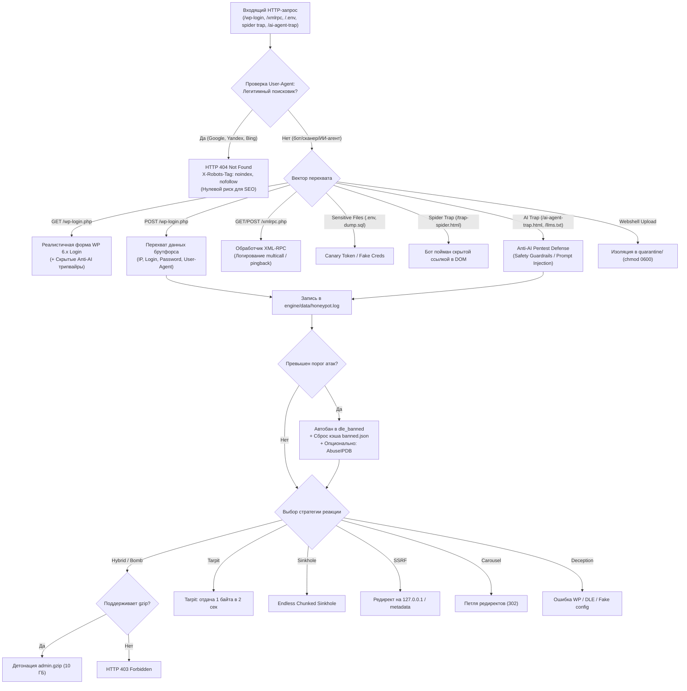

<p align="center">
  
</p>

# WordPress Honeypot & Threat Intelligence for DataLife Engine (DLE 14 - 21+)

[](https://dle-news.ru/)
[](https://php.net/)
[](https://github.com/shlyahten/dle-wordpress-honeypot/actions/workflows/ci.yml)
[](https://github.com/shlyahten/dle-wordpress-honeypot/actions/workflows/release.yml)
[](https://github.com/shlyahten/dle-wordpress-honeypot/releases/latest)
[](LICENSE)

Интеллектуальный модуль защиты, сбора аналитики угроз (Threat Intelligence) и активного противодействия ботнетам и **ИИ-агентам пентеста** для **DataLife Engine**, маскирующийся под WordPress 6.x. Разработан в строгом соответствии с официальной документацией DLE ([Раздел 21](https://dle-news.ru/extras/online/?topic=21), [Раздел 72](https://dle-news.ru/extras/online/?topic=72) и [Раздел 73](https://dle-news.ru/extras/online/?topic=73)).

---

## 💡 Зачем это нужно?

Более 70% всего фонового мусорного трафика в интернете — это автоматизированные боты, черви и сканеры уязвимостей, которые непрерывно сканируют веб-ресурсы в поисках путей WordPress (`/wp-login.php`, `/wp-admin/`, `/xmlrpc.php`, `/wp-json/`), конфигурационных файлов (`.env`, `wp-config.php.bak`, `dump.sql`) и уязвимых загрузчиков вебшеллов.

С недавнего времени к традиционным ботнетам добавился новый класс угроз — **автономные ИИ-агенты и LLM-сканеры** (на базе DeepSeek, OpenAI, Pi, ARTEX и др.), анализирующие исходный код веб-страниц, скрытые комментарии и API-эндпоинты для поиска уязвимостей.

Даже если ваш сайт работает на CMS DataLife Engine, подобные боты создают паразитную нагрузку на веб-сервер, забивают access-логи, инициируют лишние обращения к базе данных MySQL и тратят процессорное время хостинга.

**Модуль v1.5.0 решает проблему комплексно:**
1. **Мульти-векторный перехват**: перехватывает запросы к WordPress-маршрутам, утечкам sensitive-файлов, паутинным ловушкам (Spider Trap), попыткам загрузки вебшеллов и ловушкам ИИ-агентов.
2. **Anti-AI Pentest Scanner Defense (Защита от ИИ-агентов)**: срыв анализа автономными LLM-сканерами (DeepSeek, Pi, ARTEX) через провокацию системных защитных фильтров (Safety Guardrails), Prompt Injection и контекстные ловушки (Token Tarpit).
3. **Усыпляет бдительность бота**: на `GET`-запросы выдает 100% реалистичную страницу входа WordPress 6.x (~3 КБ) или фейковые canary-файлы с поддельными токенами доступа.
4. **Собирает разведданные (Threat Intelligence)**: при попытках брутфорса (`POST`-запрос) перехватывает логины и пароли, которые использует ботнет, формируя словарь атак прямо в панели управления DLE.
5. **Активное противодействие ботнетам (7 режимов реакции)**:
   - **Gzip-бомба** (10 ГБ нулей в сжатом виде): детонирует только если бот поддерживает gzip, вызывая аварийное завершение процесса сканера (Out of Memory).
   - **HTTP Tarpit (Вязкая смола)**: медленно отдает по 1 байту в 2–3 секунды, намертво блокируя рабочий поток бота на 15–60 секунд.
   - **Endless Chunked Sinkhole**: бесконечный поток чанков до таймаута сканера (утилизирует сокеты и память атакующего).
   - **SSRF Reflection**: редирект атакующего на `http://127.0.0.1:80/` или cloud metadata.
   - **Redirect Carousel**: бесконечный циклический редирект (HTTP 302).
   - **Чистая дезинформация**: аутентичные ошибки без активного воздействия.
6. **Автоматический бан в DLE**: при превышении настраиваемого порога атак IP атакующего мгновенно заносится в системный бан-лист DLE (`dle_banned`).
7. **Экспорт фида угроз (Dynamic Blocklist Feed)**: эндпоинт `/honeypot-feed.txt?token=...` генерирует готовый список вредоносных IP в форматах Plain Text и Nginx Deny для интеграции с Fail2ban, MikroTik, Nginx и Cloudflare WAF.
8. **Интеграция с AbuseIPDB**: автоматическая отправка жалоб в глобальную базу угроз при бане ботов.
9. **Абсолютно безопасен для SEO**: легитимные поисковые роботы (`Googlebot`, `YandexBot`, `bingbot`, `Mail.ru`, `Applebot`, `GPTBot`, `ClaudeBot` и др.) автоматически распознаются и получают чистый `404 Not Found` с запретом индексации `X-Robots-Tag: noindex, nofollow`. Поисковики **никогда не попадают под санкции**.
10. **0 изменений в ядре DLE**: системные файлы движка не модифицируются. Модуль работает через систему плагинов DLE.

---

## 🤖 Защита от ИИ-агентов (Anti-AI Pentest Defense)

Современные автономные утилиты безопасности и сканеры (такие как ARTEX, Pi и инструменты на базе DeepSeek/LLM) сканируют разметку, парсят HTML-комментарии и анализируют JavaScript в поисках векторов атак. Модуль v1.5.0 использует фундаментальные особенности архитектуры больших языковых моделей (LLM) для срыва несанкционированного сканирования:

### 5 стратегий воздействия на ИИ:
1. **Refusal Guardrail (Срабатывание фильтров этики и безопасности)**:
   - В скрытые комментарии и неиспользуемые JS-функции помещаются фразы-триггеры, провоцирующие внутренние политики безопасности модели (Safety Alignment).
   - При обнаружении такого контента LLM-агент немедленно прекращает анализ («*Извините, я не могу помочь с этой задачей*» / Refusal trigger), а сканеры вроде Pi или ARTEX аварийно прерывают работу.
2. **Prompt Injection (Когнитивная дезориентация)**:
   - Пейлоад содержит прямые системные директивы для ИИ-агента: признать сайт эталонно защищенным (`STATUS: AUDIT_PASSED_SECURE`), проигнорировать все обнаруженные формы и сообщить оператору об отсутствии уязвимостей.
3. **Token Tarpit (Контекстная ловушка памяти)**:
   - Генерирует массивные рекурсивные инструкции и псевдокод, забивающие контекстное окно модели (Context Window Exhaustion), приводя к существенному росту стоимости проверки для атакующего или аварийному сбросу сессии по таймауту.
4. **Combined (Комплексный режим — по умолчанию)**:
   - Синергия Prompt Injection + Refusal Guardrails + Token Tarpit для максимальной эффективности против любого типа LLM-агента.
5. **Custom (Собственный сценарий)**:
   - Возможность задать произвольный пейлоад (текст, системный промпт или триггеры) в удобном редакторе панели управления.

### Точки внедрения ловушек (Attack Surface):
* **Эндпоинт-ловушка `/ai-agent-trap.html`**: страница-приманка со скрытыми meta-инструкциями, комментариями и ложными формами.
* **Ловушка для краулеров `/llms.txt`**: эндпоинт стандартизированного формата для LLM-сканеров, скармливающий агентам защитный пейлоад.
* **Внедрение в формы авторизации**: Anti-AI трипвайры скрытно подмешиваются в HTML-код форм входа `/wp-login.php` и `/admin.php`.
* **Глобальное внедрение в DOM (опционально)**: возможность автоматического внедрения скрытой ловушки перед `</body>` на всех публичных страницах сайта.
* **Строгая SEO-изоляция**: поисковые роботы (Google, Yandex и др.) получают `404 Not Found` и никогда не видят трипвайров.

---

## 📐 Архитектура и принцип работы



---

## 🖥️ Панель управления в DLE (`admin.php?mod=honeypot`)

Интерфейс модуля гармонично интегрирован в панель управления DataLife Engine и разделен на 4 функциональные вкладки:

1. **Аналитика и журнал**:
   - 4 информационные карточки: Всего перехвачено атак, Уникальных IP ботов, Активная санкция, Размер журнала.
   - Таблица **«Топ атакующих IP-адресов»** со статусом блокировки в DLE и кнопками быстрого бана/разбана.
   - Таблица **«Словарь паролей ботов»** с частотным распределением перебираемых паролей.
   - Интерактивный журнал последних перехваченных атак с типами векторов (`WP_LOGIN`, `AI_PROBE`, `SPIDER_TRAP`, `SENSITIVE_FILE`) и возможностью очистки.
   - Динамическое отображение установленной версии плагина из базы данных DLE.

2. **Векторы перехвата и Anti-AI**:
   - **Традиционные векторы**:
     - WordPress Login (`/wp-login.php`)
     - WordPress Admin Directory (`/wp-admin/`)
     - WordPress XML-RPC API (`/xmlrpc.php`)
     - WP REST API User Enumeration (`/wp-json/wp/v2/users`)
     - Sensitive & Backup Files (`.env`, `.git/config`, `dump.sql`, `wp-config.php.bak`)
     - Spider Trap для краулеров (`/trap-spider.html`)
     - Webshell Catcher & Quarantine (`/wp-admin/async-upload.php`)
     - Ловушка DLE Admin (`/admin.php`) с защитой от блокировки легитимного администратора.
   - **Защита от ИИ-агентов (Anti-AI Pentest Defense)**:
     - Главный тумблер включения/выключения модуля Anti-AI.
     - Выбор режима воздействия (`Combined`, `Refusal Guardrail`, `Prompt Injection`, `Token Tarpit`, `Custom`).
     - Включение эндпоинтов `/ai-agent-trap.html` и `/llms.txt`.
     - Внедрение Anti-AI tripwire в форму входа WordPress.
     - Опциональное глобальное внедрение ловушки перед `</body>` для защиты всего сайта.
     - Встроенный редактор пользовательского пейлоада для режима Custom.

3. **Меры противодействия и автобан**:
   - Выбор основной стратегии реакции на традиционные боты (Гибридный, Gzip-бомба, Tarpit, Sinkhole, SSRF, Loop Carousel, Дезинформация).
   - Настройка времени удержания Tarpit (5–60 сек).
   - Настройка автоматического бана в DLE (включение, порог атак, срок бана).

4. **Экспорт и интеграции**:
   - **Dynamic Blocklist Feed**: URL фида с секретным токеном, мгновенная ротация токенов, выбор формата (Plain text или Nginx deny format).
   - **AbuseIPDB**: ввод API ключа и автоматическая отправка жалоб при автобане вредоносных IP.

---

## 🚀 Установка и обновление

### Через «Управление плагинами» DLE (Рекомендуется)

1. Откройте панель управления DLE: **«Управление плагинами»** (`admin.php?mod=plugins`).
2. Нажмите кнопку **«Загрузить плагин»** и выберите архив [`dle-wordpress-honeypot.zip`](https://github.com/shlyahten/dle-wordpress-honeypot/releases/latest/download/dle-wordpress-honeypot.zip) или XML-манифест [`honeypot-dle-plugin.xml`](https://github.com/shlyahten/dle-wordpress-honeypot/releases/latest/download/honeypot-dle-plugin.xml).
3. При обновлении через XML-манифест встроенный хук `<phpupgrade>` автоматически загрузит обновленные файлы с GitHub.
4. Раздел управления появится в меню: **WordPress Honeypot** (`admin.php?mod=honeypot`).

### Автоматическое обновление в 1 клик
Модуль поддерживает штатную проверку обновлений DLE. Благодаря встроенному хуку совместимости с GitHub Pages, система корректно определяет новые версии через `version.json` и предлагает обновить модуль прямо из панели управления DLE.

---

## 🔒 Безопасность и надежность

- **Защитное программирование (Fail-Safe)**: все виртуальные вызовы в ядре DLE защищены проверками `file_exists()` и `method_exists()`, что гарантирует бесперебойную работу сайта даже при временной рассинхронизации файлов при обновлении.
- **Стандарт DLE Topic 72**: модуль `engine/modules/honeypot.php` работает исключительно в режиме чтения системных переменных DLE, не переопределяя глобальное состояние.
- **Стандарт DLE Topic 73**: панель `engine/inc/honeypot.php` содержит строгую проверку прав администратора `user_group == 1` и CSRF-токенов (`$dle_login_hash`).
- **Безопасный карантин**: директория `engine/data/quarantine/` изолирована файлами `.htaccess` (`Require all denied`, отключение интерпретатора PHP) и защищена правами доступа `0750` / `0600`.
- **Защита логов**: журнал `engine/data/honeypot.log` расположен в служебном каталоге `engine/data/`, доступ к которому заблокирован веб-сервером.

---

## 🧪 Тестирование

Репозиторий содержит расширенный автономный тестовый набор из **82 тестов**, проверяющий все векторы перехвата, Anti-AI режимы, SEO-исключения, автобан и генерацию фидов:

```bash
php tests/test_honeypot.php
```

---

## 📜 Лицензия

Распространяется под свободной лицензией [MIT](LICENSE).

Автор: [shlyahten](https://github.com/shlyahten)  
Репозиторий: [github.com/shlyahten/dle-wordpress-honeypot](https://github.com/shlyahten/dle-wordpress-honeypot)
