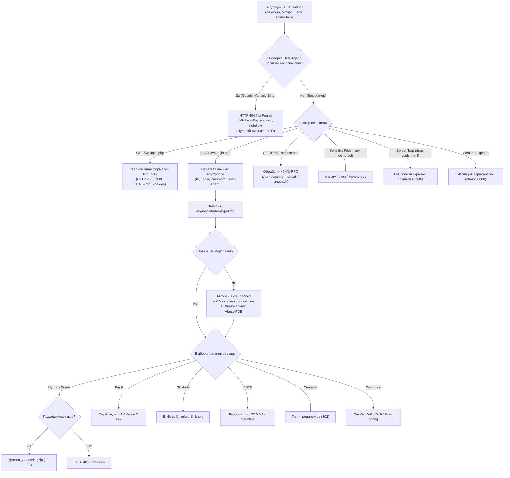

  

# WordPress Honeypot & Threat Intelligence for DataLife Engine (DLE 14 - 21+)

Интеллектуальный модуль защиты и сбора аналитики угроз (Threat Intelligence) для **DataLife Engine**, маскирующийся под WordPress 6.x. Разработан в строгом соответствии с официальной документацией DLE ([Раздел 72](https://dle-news.ru/extras/online/?topic=72) и [Раздел 73](https://dle-news.ru/extras/online/?topic=73)).

---

## 💡 Зачем это нужно?

Более 70% всего фонового мусорного трафика в рунете и мировом интернете — это автоматизированные боты, черви и сканеры уязвимостей, которые непрерывно сканируют веб-сайты в поисках WordPress (`/wp-login.php`, `/wp-admin/`, `/xmlrpc.php`, `/wp-json/`), конфигурационных файлов (`.env`, `wp-config.php.bak`, `dump.sql`) и уязвимых загрузчиков вебшеллов.

Даже если ваш сайт работает на другой CMS (DataLife Engine), сканеры нагружают веб-сервер, забивают access-логи, вызывают лишние обращения к базе данных MySQL и тратят ценные ресурсы хостинга.

**Модуль v1.4.0 решает проблему комплексно:**
1. **Мульти-векторный перехват**: перехватывает запросы к WordPress-маршрутам, утечкам sensitive-файлов, паутинным ловушкам (Spider Trap) и попыткам загрузки вебшеллов.
2. **Усыпляет бдительность бота**: на `GET`-запросы выдает 100% реалистичную страницу входа WordPress 6.x (~3 КБ) или фейковые canary-файлы с поддельными токенами доступа.
3. **Собирает разведданные (Threat Intelligence)**: при попытках брутфорса (`POST`-запрос) перехватывает логины и пароли, которые использует ботнет, формируя словарь атак прямо в панели управления DLE.
4. **Активное противодействие (7 режимов реакции)**:
   - **Gzip-бомба** (10 ГБ нулей в сжатом виде): детонирует только если бот поддерживает gzip, вызывая аварийное завершение процесса сканера (Out of Memory).
   - **HTTP Tarpit (Вязкая смола)**: медленно отдает по 1 байту в 2–3 секунды, намертво блокируя рабочий поток бота на 15–60 секунд.
   - **Endless Chunked Sinkhole**: бесконечный поток чанков до таймаута сканера (утилизирует сокеты и память атакующего).
   - **SSRF Reflection**: редирект атакующего на `http://127.0.0.1:80/` или cloud metadata.
   - **Redirect Carousel**: бесконечный циклический редирект (HTTP 302).
   - **Чистая дезинформация**: аутентичные ошибки без активного воздействия.
5. **Автоматический бан в DLE**: при превышении настраиваемого порога атак IP атакующего мгновенно заносится в системный бан-лист DLE (`dle_banned`).
6. **Экспорт фида угроз (Dynamic Blocklist Feed)**: эндпоинт `/honeypot-feed.txt?token=...` генерирует готовый список вредоносных IP в форматах Plain Text и Nginx Deny для прямой интеграции с Fail2ban, MikroTik, Nginx и Cloudflare WAF.
7. **Интеграция с AbuseIPDB**: автоматическая отправка жалоб в глобальную базу угроз при бане ботов.
8. **Абсолютно безопасен для SEO**: легитимные поисковые роботы (`Googlebot`, `YandexBot`, `bingbot`, `Mail.ru`, `Applebot`, `GPTBot`, `ClaudeBot` и др.) автоматически распознаются и получают чистый `404 Not Found` с запретом индексации `X-Robots-Tag: noindex, nofollow`. Поисковики **никогда не попадают под санкции**.
9. **0 изменений в ядре DLE**: системные файлы движка не модифицируются. Модуль работает через систему плагинов DLE.

---

## 📐 Архитектура и принцип работы

---

## 🖥️ Панель управления в DLE (`admin.php?mod=honeypot`)

Интерфейс разделен на 4 удобные вкладки:

1. **Аналитика и журнал**:
   - 4 карточки метрик: Всего перехвачено атак, Уникальных IP ботов, Активная санкция, Размер журнала.
   - Таблица **«Топ атакующих IP-адресов»** со статусом блокировки в DLE и кнопками быстрого бана/разбана.
   - Таблица **«Словарь паролей ботов»** с частотным распределением перебираемых паролей.
   - Полный журнал последних 50 перехваченных атак с возможностью очистки.

2. **Векторы перехвата**:
   - Независимые тумблеры включения/отключения каждого вектора:
     - WordPress Login (`/wp-login.php`)
     - WordPress Admin Directory (`/wp-admin/`)
     - WordPress XML-RPC API (`/xmlrpc.php`)
     - WP REST API User Enumeration (`/wp-json/wp/v2/users`)
     - Sensitive & Backup Files (`.env`, `.git/config`, `dump.sql`, `wp-config.php.bak`)
     - Spider Trap для краулеров (`/trap-spider.html`)
     - Webshell Catcher & Quarantine (`/wp-admin/async-upload.php`)
   - Управление приманкой DLE Admin (`/admin.php`) с защитой от блокировки администратора.

3. **Меры противодействия и автобан**:
   - Выбор основной стратегии реакции (Гибридный, Gzip-бомба, Tarpit, Sinkhole, SSRF, Loop Carousel, Дезинформация).
   - Настройка времени удержания Tarpit (5–60 сек).
   - Настройка автоматического бана в DLE (включение, порог атак, срок бана).

4. **Экспорт и интеграции**:
   - **Dynamic Blocklist Feed**: URL фида с секретным токеном, генерация новых токенов, выбор формата (Plain text или Nginx deny format).
   - **AbuseIPDB**: ввод API ключа и автоматическая отправка жалоб при автобане.

---

## 🚀 Установка и обновление

### Через «Управление плагинами» DLE (Рекомендуется)

1. Откройте панель управления DLE: **«Управление плагинами»** (`admin.php?mod=plugins`).
2. Нажмите кнопку **«Загрузить плагин»** и выберите архив [`dle-wordpress-honeypot.zip`](https://github.com/shlyahten/dle-wordpress-honeypot/releases/latest/download/dle-wordpress-honeypot.zip) или XML-манифест [`honeypot-dle-plugin.xml`](https://github.com/shlyahten/dle-wordpress-honeypot/releases/latest/download/honeypot-dle-plugin.xml).
3. Скопируйте файлы из каталога `upload/` в корень сайта (при ручной установке).
4. Раздел появится в меню: **WordPress Honeypot** (`admin.php?mod=honeypot`).

---

## 🔒 Безопасность и соответствие стандартам

- **Стандарт DLE Topic 72**: модуль `engine/modules/honeypot.php` работает исключительно в режиме чтения системных переменных DLE, не переопределяя глобальное состояние.
- **Стандарт DLE Topic 73**: панель `engine/inc/honeypot.php` содержит строгую проверку прав администратора `user_group == 1` и токенов защиты от CSRF (`$dle_login_hash`).
- **Безопасный карантин**: директория `engine/data/quarantine/` защищена файлами `.htaccess` (`Require all denied`, отключение всех PHP/CGI обработчиков) и имеет права доступа `0750` / `0600`.
- **Защита логов**: журнал `engine/data/honeypot.log` расположен в закрытом каталоге `engine/data/`, доступ к которому заблокирован веб-сервером.

---

## 📜 Лицензия

Распространяется под свободной лицензией [MIT](LICENSE).

Автор: [shlyahten](https://github.com/shlyahten)  
Репозиторий: [github.com/shlyahten/dle-wordpress-honeypot](https://github.com/shlyahten/dle-wordpress-honeypot)
